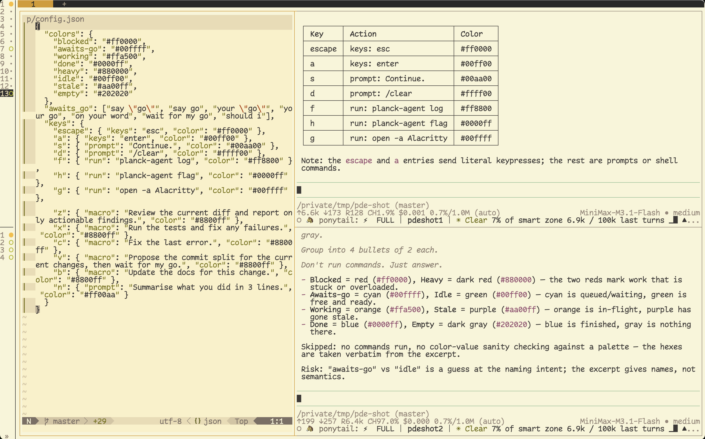

# .dotfiles

My current dev environment

- [brew](https://brew.sh)
  - [Brewfile](Brewfile) to install my apps
- [neovim](https://neovim.io) (text editor from terminal)
- [alacritty](https://alacritty.org/) (terminal emulator)
- [tmux](https://github.com/tmux/tmux) (terminal multiplexer to handle my tabs/panes)
- zsh, [starship](https://starship.rs/)
- [pi](https://pi.dev) (AI coding agent)
  - [pi/](pi) holds the whole pi setup: `pi/install.sh` installs the packages, `pi/agent/` is the agent directory
- [Comic Code font](https://tosche.net/fonts/comic-code)

