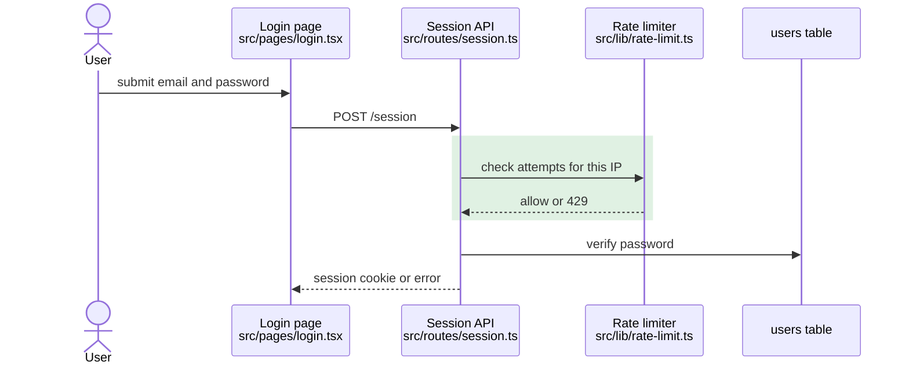

# Block format

Copy this shape. Remove an optional line (Unchanged, Related paths) only when it has no real content. Keep a blank line around every code fence and table, or GitHub does not render them.

The values below are an illustration.

## Full form

````markdown
<!-- pr-visual-recap:start -->

### System change · risk: **high** (changes the login flow)

**Head:** `a1b2c3d` · **Base:** `main`

| Surface | Kind | Change |
|---|---|---|
| Login page<br/>`src/pages/login.tsx` | page | changed |
| Session API<br/>`src/routes/session.ts` | endpoint | changed |
| Rate limiter<br/>`src/lib/rate-limit.ts` | service | new |



🟩 new

**Unchanged:** password hashing, the session cookie format.

**Related paths:** mobile login endpoint: not updated, it has its own limiter.

<!-- pr-visual-recap:end -->
````

## One-line form (trivial PR)

````markdown
<!-- pr-visual-recap:start -->

### System change · risk: **low** (display only)

**Head:** `a1b2c3d` · No system flow change: the footer now shows the app version.

<!-- pr-visual-recap:end -->
````
