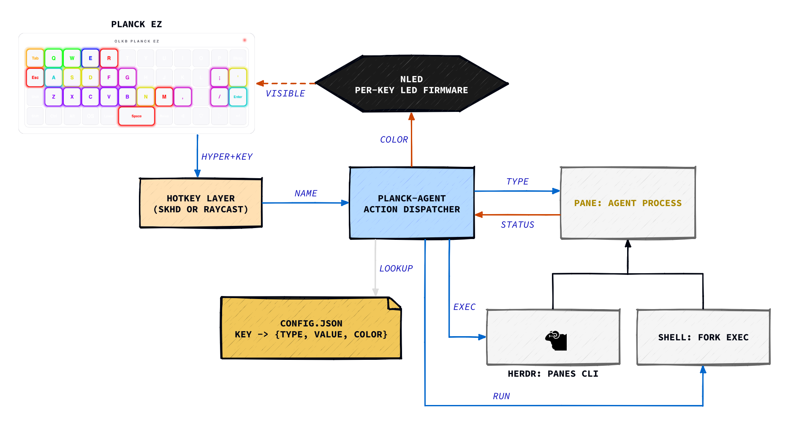

# planck-agent

Turn a Planck EZ Glow into a control deck for [herdr](https://herdr.dev) coding agents. One key per agent, live status lights, and a row of macro keys. No firmware hacking: the stock Oryx firmware and ZSA's [Kontroll](https://github.com/zsa/kontroll) do the work.

Inspired by [micro-manager](https://github.com/schacon/micro-manager), which does this for the Work Louder Creator Micro 2.

## What you get

| Row | Keys | Action |
|---|---|---|
| 1 | Tab, Q…P, ⌫ | focus agent 1–12 and raise the terminal |
| 2 | Esc, A…L, ;, ' | commands: accept, interrupt, continue, clear, jj panes, terminal |
| 3 | ⇧, Z…/, ⏎ | macros and prompts, your text |
| Space | | the worst state across all agents |

LED colours: red blocked, orange working, blue done (unseen), green idle, dark empty. Row 2 and 3 keys show the colour you give them in config.

The lights and keys are active only on the agent layer. On other layers the board shows its normal Oryx colours.

## Requirements

- macOS, a Planck EZ Glow, [herdr](https://herdr.dev).
- [Keymapp](https://www.zsa.io/flash) 1.3+ running with its API enabled (Settings → Enable API).
- `kontroll`, `jq` (ships with macOS), and a hotkey tool: [skhd](https://github.com/koekeishiya/skhd) or [Raycast](https://raycast.com).

## 1. Layout (Oryx, once)

Add an agent layer. Each key sends Hyper (⌃⌥⇧⌘) plus the chord below. Add a `TG(n)` key on your base layer to toggle it.

| Row | Chords |
|---|---|
| 1 | Hyper + 1 2 3 4 5 6 7 8 9 0 - = |
| 2 | Meh+Q, then Hyper + W E R T Y U I O P [ ] |
| 3 | Hyper + A S D F G H J K L ; ' ⏎ |

Q uses Meh (⌃⌥⇧) only, because macOS and Raycast refuse ⌘Q. Flash with Keymapp. If `kontroll set-layer` answers "keyboard requires an updated firmware", recompile the layout in Oryx and flash again.

## 2. Install

```
brew install --cask keymapp
brew install protobuf && cargo install kontroll
git clone https://github.com/strdr4605/.dotfiles && cd .dotfiles/planck-agent
ln -sf $PWD/bin/planck-agent ~/.local/bin/planck-agent
mkdir -p ~/.config/planck-agent && cp config.example.json ~/.config/planck-agent/config.json
cp planck-agent.plist ~/Library/LaunchAgents/ && launchctl bootstrap gui/$UID ~/Library/LaunchAgents/planck-agent.plist
```

The launchd job runs the LED loop at login and restarts it if it dies.

## 3. Hotkeys

Pick one. Never both, or each key fires twice.

**skhd** (config as code, needs the Accessibility permission):

```
brew install koekeishiya/formulae/skhd
ln -sf $PWD/skhdrc ~/.config/skhd/skhdrc
skhd --start-service
```

**Raycast** (no new permission, works under MDM): Settings → Extensions → Script Commands → Add Directory → `raycast/`. Then record each hotkey by pressing the Planck key on the agent layer: "Agent 1–12" are row 1, "Key escape…'" row 2, "Key shift…enter" row 3.

## Config

`~/.config/planck-agent/config.json`. Edits apply live.

```json
{
  "colors": { "blocked": "#ff0000", "working": "#ffa500", "done": "#0000ff", "idle": "#00ff00", "empty": "#202020" },
  "keys": {
    "a": { "keys": "enter", "color": "#00ff00" },
    "s": { "prompt": "Continue.", "color": "#00aa00" },
    "f": { "run": "planck-agent log", "color": "#ff8800" },
    "z": { "macro": "Review the current diff and report only actionable findings.", "color": "#8800ff" }
  }
}
```

Keys are named by the printed keycap: `escape a … l ; '` for row 2 and `shift z … m , . / enter` for row 3. Each key has one action and a colour:

| Action | Does |
|---|---|
| `macro` | types the text into the focused agent, does not submit |
| `prompt` | types and submits |
| `keys` | sends key names to the agent, e.g. `enter`, `esc` |
| `run` | runs a shell command |

See `config.example.json` for the full default layout.

## Commands

```
planck-agent focus N   # focus herdr agent N and raise the terminal
planck-agent key K     # run the config action for keycap K
planck-agent log       # toggle jj log + jj status panes beside the focused agent
planck-agent leds      # the LED loop (run by launchd)
```

Environment: `PLANCK_AGENT_LAYER` (default 5), `PLANCK_TERMINAL_APP` (default Alacritty), `PLANCK_AGENT_CONFIG`.

## How it works

The LED loop polls `kontroll status` once a second. On the agent layer it reads `herdr agent list` and paints row 1 with each agent's state, rows 2–3 with the configured colours, and the spacebar with the worst state. Off the layer it restores the Oryx colours. Key presses reach the script through the hotkey tool, which calls the herdr CLI.

Agent slots follow herdr's sidebar order, so a new agent can shift the others by one.



See [`docs/architecture.d2`](docs/architecture.d2) for the source. Regenerate after changing `config.json`:

```
cd docs && ./make.sh
```
