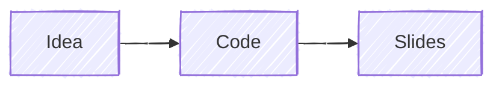

# Lecture title

Course name · Week 1

---

# Agenda

<v-clicks>

- Topic one
- Topic two
- Topic three

</v-clicks>

---

# Code

```ts {1|2-3|all}
const students = await db.students.findMany()
const passed = students.filter(s => s.grade >= 5)
console.log(`${passed.length} passed => ok`)
```

---

# Diagram



---
layout: two-cols
---

# Left side

Text, bullets or an image.

::right::


---
layout: center
class: text-center
---

# Questions?
